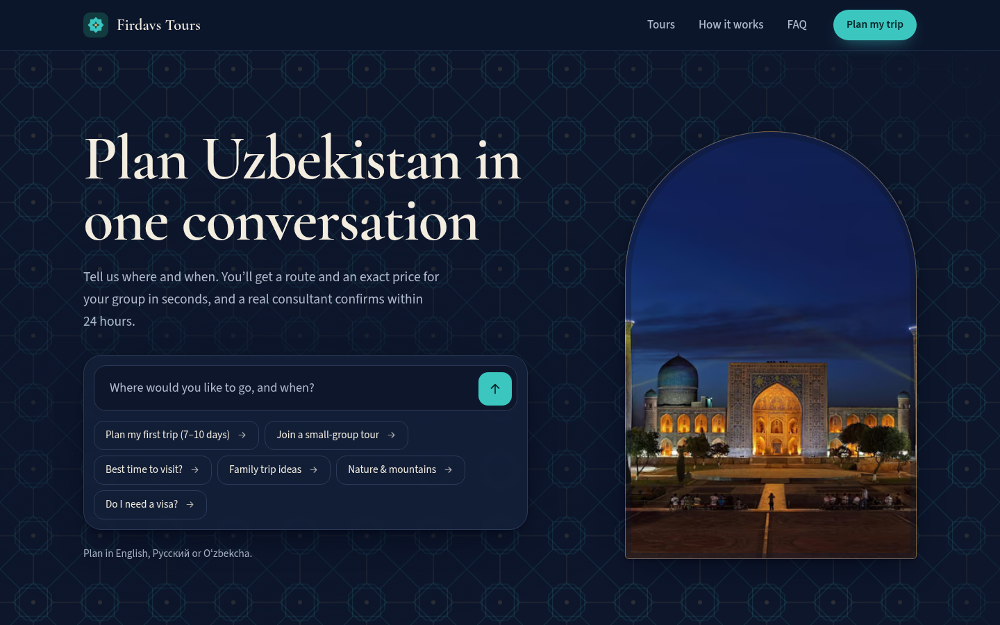
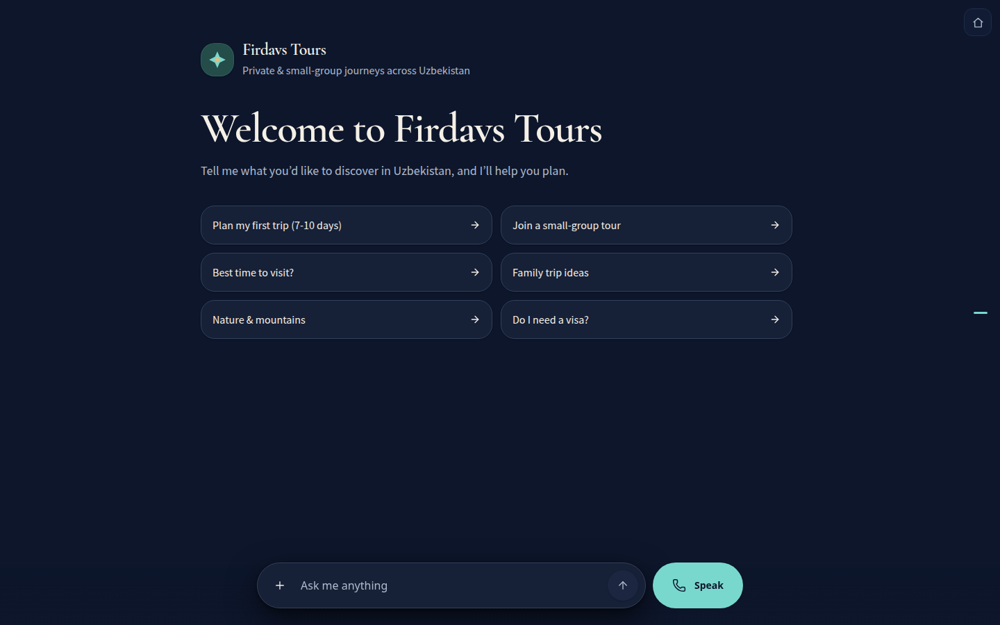
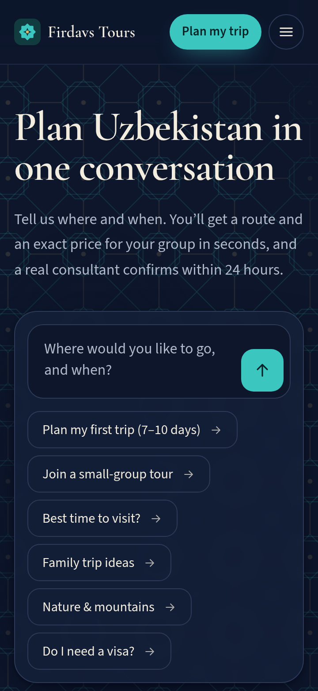
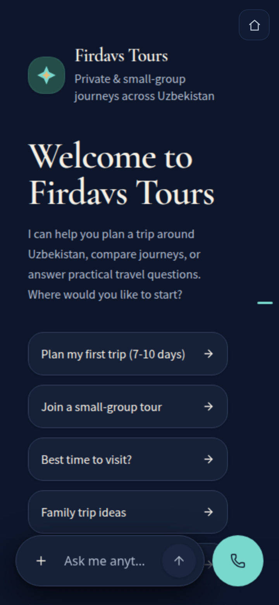

# Firdavs Tours

**Plan Uzbekistan in one conversation.** Firdavs Tours is a travel site for private and small-group journeys across Uzbekistan. Travellers describe their trip in English, Russian or Uzbek, get a route and an exact price for their group in seconds, and a human consultant confirms within 24 hours.

**Live:** https://tours.fhsystems.dev

| Landing | Planner |
|---|---|
|  |  |

| Landing at 360px | Planner at 360px | Light theme |
|---|---|---|
|  |  |  |

## What's here

| Route | What it is |
|---|---|
| `/` | Landing page. The hero *is* the conversation starter: type a question or tap a starter and the planner opens with it already asked. Featured journeys, how it works, destinations, FAQ |
| `/plan` | The trip planner, full-screen and seamless |
| `/about` | Case study: how the planner was tested (48% → 76% → 44% → 100% on 25 conversations) |
| `/credits` | Photo credits (Wikimedia Commons) |
| `/api/*` | Quote, departures and booking-request functions the planner uses as tools, documented in [docs/API.md](docs/API.md) |

The question reaches the planner over the planner's own parent-frame message channel, with a clipboard fallback. See [docs/AGENT_HANDOFF.md](docs/AGENT_HANDOFF.md).

## Stack

- **Astro 6**, static output, no client framework. Images go through `astro:assets` (AVIF/WebP, responsive, lazy), and the fonts are self-hosted (Cormorant Garamond, Source Sans 3).
- **Vercel**: `dist/` for the site, zero-config Node functions in `api/`, Upstash Redis for booking requests.
- **Single source of truth:** `lib/tours.json` drives both the site (names, routes, highlights, "from" prices, departures) and the quote API.
- Follows the OS light/dark scheme, the same as the planner. No analytics or tracking.

## Run

Requires Node 22.

```bash
npm install
npm run dev        # http://localhost:4321  (the functions in api/ run under `vercel dev`)
npm run build      # static site → dist/
npm run preview
```

## Tests

```bash
npm test                          # 16 unit tests: pricing tiers, supplements, departures, validation, idempotency, rate limit, auth
npm run test:e2e                  # Playwright smoke tests (desktop + 360px), against a local build
PW_CHANNEL=chrome npm run test:e2e                 # use the installed Chrome instead of Playwright's browser
BASE_URL=https://<deployment> npm run test:e2e     # run against a deployment
LIVE=1 npm run test:e2e -g "live planner"          # one round trip through the real planner
```

The e2e suite covers the landing page, real prices on every tour card, JSON-LD, hero submit, chip and card handoff (against a protocol stub, so runs cost nothing), the clipboard fallback, /plan full-screen geometry, /about, 404, robots and sitemap, horizontal overflow at 360px, and a check that no page shows implementation words.

## Project layout

```
api/            serverless functions (quote, departures, requests, tours, health)
lib/            tours.json + pricing/validation core shared by functions and site
src/pages/      index, plan, about, credits, 404, robots.txt, sitemap.xml
src/components/ header, footer, brand mark, tile field, icons
src/assets/     photographs (see /credits)
e2e/            Playwright smoke tests
docs/           API reference, handoff notes, screenshots
```

Firdavs Tours is a demonstration brand based on real 2026 prices. Built by [fhsystems](https://fhsystems.dev).
