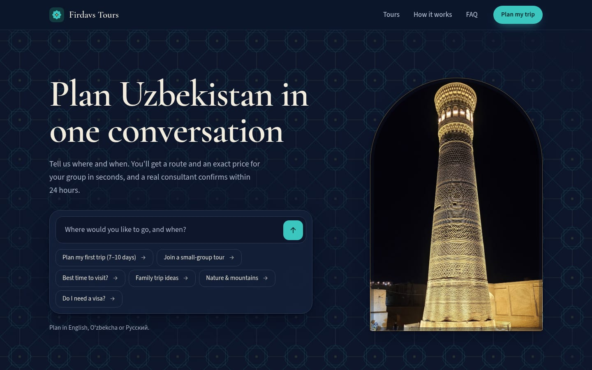
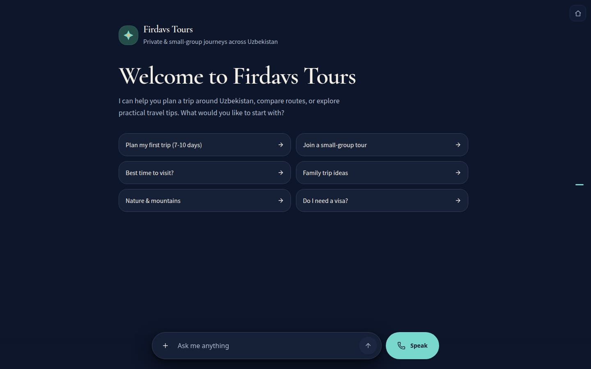
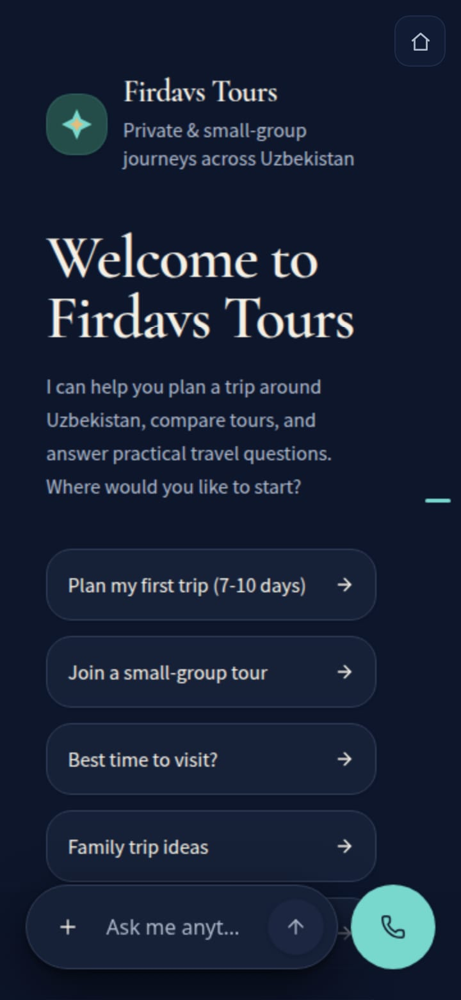
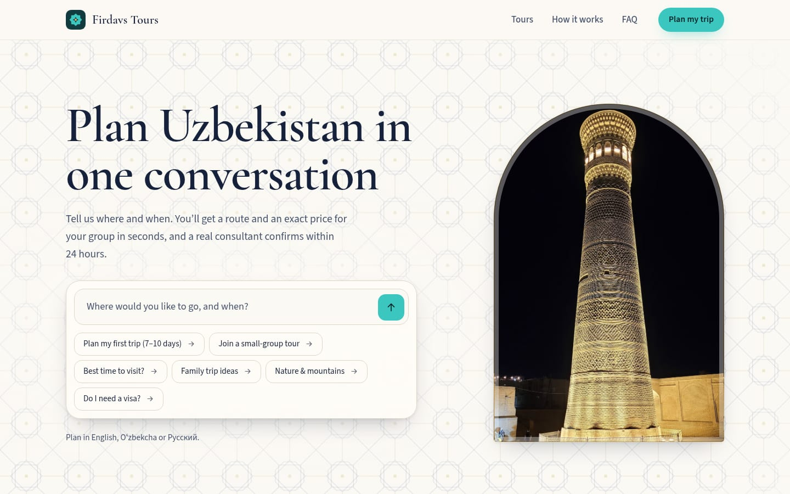

# Firdavs Tours

**Plan Uzbekistan in one conversation.** Firdavs Tours is a travel site for private and small-group journeys across Uzbekistan. Travellers describe their trip in English, Uzbek or Russian, get a route and an exact price for their group in seconds, and a human consultant confirms within 24 hours.

**Live:** https://tours.fhsystems.dev · **Built by [fhsystems](https://fhsystems.dev)**. Firdavs Tours is a demo brand on real 2026 prices, and the site doubles as an fhsystems portfolio piece.

| Landing | Planner |
|---|---|
|  |  |

| Landing at 360px | Planner at 360px | Light theme |
|---|---|---|
|  |  |  |

## What's here

| Route | What it is |
|---|---|
| `/` | Landing page. The hero *is* the conversation starter: type a question or tap a starter and the planner opens with it already asked. Featured journeys, how it works, destinations, FAQ |
| `/plan` | The trip planner, full-screen and seamless. If the planner doesn't answer within 10 s, a short enquiry form takes its place |
| `/about` | Case study: at a glance, eval chart (48% → 76% → 44% → 100% on 25 conversations), architecture, lessons, known limits, optional demo video |
| `/credits` | Photo credits (Wikimedia Commons) |
| `/api/*` | Quote, departures and booking-request functions the planner uses as tools, documented in [docs/API.md](docs/API.md) |

The question reaches the planner over the planner's own parent-frame message channel, with a clipboard fallback. See [docs/AGENT_HANDOFF.md](docs/AGENT_HANDOFF.md).

## Stack

- **Astro 6**, static output, no client framework. Images go through `astro:assets` (AVIF/WebP, responsive, lazy), and the fonts are self-hosted (Cormorant Garamond, Source Sans 3).
- **Vercel**: `dist/` for the site, zero-config Node functions in `api/`, Upstash Redis for booking requests.
- **Single source of truth:** `lib/tours.json` drives both the site (names, routes, highlights, "from" prices, departures) and the quote API.
- Follows the OS light/dark scheme, the same as the planner.
- PostHog analytics on the live host only, cookieless, loaded lazily (see [Analytics](#analytics)).

## Run

Requires Node 22.

```bash
npm install
npm run dev        # http://localhost:4321  (the functions in api/ run under `vercel dev`)
npm run build      # static site → dist/
npm run preview
```

## Tests

```bash
npm test                          # 31 unit tests: pricing, validation, idempotency, rate limit, auth, Telegram alert, server analytics
npm run test:e2e                  # Playwright smoke tests (desktop + 360px), against a local build
PW_CHANNEL=chrome npm run test:e2e                 # use the installed Chrome instead of Playwright's browser
BASE_URL=https://<deployment> npm run test:e2e     # run against a deployment
LIVE=1 npm run test:e2e -g "live planner"          # one round trip through the real planner
```

The e2e suite covers the planner-outage fallback (form, validation, retries without duplicates, recovery), the agency CTAs and their UTM tags on every page, the /plan demo chip placement, the sticky mobile bar, analytics staying silent on localhost and preview hosts (and, on a simulated live host, that the typed question is never sent), the landing page, real prices on every tour card, JSON-LD, hero submit, chip and card handoff (against a protocol stub, so runs cost nothing), the clipboard fallback, /plan full-screen geometry, /about, 404, robots and sitemap, horizontal overflow at 360px, and a check that no page shows implementation words.

## fhsystems CTAs

Every link to the agency carries `utm_source=tours` and its placement as `utm_medium`, and a `data-agency` attribute that analytics reports as `agency_cta_click {placement}`.

| Where | Link | `utm_medium` / `placement` |
|---|---|---|
| Footer line on every page (incl. 404): "Build mine" | `https://fhsystems.dev/?utm_source=tours&utm_medium=footer` | `footer` |
| Landing section "Want a planner like this for your business?" | `…&utm_medium=section` | `section` |
| /about CTA block and "Demo project by fhsystems" label | `…&utm_medium=about` | `about`, `about_label` |
| Footer "Built by fhsystems" badge | `https://fhsystems.dev` (unchanged) | `footer_badge` |
| /plan "Demo by fhsystems" chip | `/about` | `plan_chip` |

## Environment variables

| Variable | Purpose |
|---|---|
| `KV_REST_API_URL`, `KV_REST_API_TOKEN` | Upstash Redis, added by the Vercel integration. Without them, requests live in memory (demo only) |
| `ADMIN_TOKEN` | Bearer token for `GET /api/requests` |
| `TELEGRAM_BOT_TOKEN`, `TELEGRAM_CHAT_ID` | Telegram alert for every new booking request. Off until both are set |
| `VERCEL_ENV` | Set by Vercel. Server-side analytics only runs when it is `production` |

**Switching on Telegram alerts:** create a bot with [BotFather](https://t.me/BotFather) and copy its token; add the bot to the sales chat (or message it), then read the chat id from `https://api.telegram.org/bot<token>/getUpdates`. Add both as Production environment variables in Vercel and redeploy. Each request then posts its reference, tour, dates, group size, hotel class, total price, language and contact.

## Analytics

PostHog, the same project as fhsystems.dev (EU). The key in `lib/posthog-key.js` is public by design.

- Browser: only on `tours.fhsystems.dev`, so localhost and preview hosts never fetch it. `posthog-js` is a separate chunk, loaded on the first interaction (or after 6 s) on content pages and on the first idle frame on /plan, so it never competes with the first render. Cookieless (`persistence: memory`), `person_profiles: identified_only`, events go through the same-origin `/ingest` proxy (`vercel.json` rewrites), super property `site: "tours"`.
- Server: `lib/analytics.js` posts to `https://eu.i.posthog.com/i/v0/e/` after the response is sent, only when `VERCEL_ENV=production`, with `$process_person_profile: false`, an 800 ms cap, and no name, contact or IP.
- The typed question is never sent, only whether there was one and its length.

| Event | Properties | Where |
|---|---|---|
| `$pageview`, `$pageleave`, web vitals | | every page |
| `section_viewed` | `section` (hero, tours, how, why, destinations, faq, agency, closing) | landing |
| `planner_opened` | `source` (typed, chip, tour_card, destination, header, footer, cta, direct), `has_question`, `question_length` | /plan |
| `planner_handoff` | `state` (delivered, failed) | /plan |
| `planner_unavailable` | `reason`, `has_question` | /plan, planner didn't answer within 10 s |
| `planner_recovered` | | /plan, planner answered after the outage form was shown |
| `planner_copy_clicked` | | /plan clipboard hint |
| `agency_cta_click` | `placement` | every fhsystems CTA |
| `outbound_clicked` | `host`, `place` | any external link |
| `quote_served` | `tour`, `pax`, `hotel_class`, `ok` | `GET /api/quote` |
| `booking_request_created` | `kind` (booking, enquiry), `channel` (planner, plan_fallback), `tour_id`, `travellers`, `hotel_class`, `language` | `POST /api/requests` |

The planner source is kept in `sessionStorage` between the click and /plan (`src/scripts/plan-source.ts`), so the `/plan?q=` URLs stay unchanged.

## Demo video

Put the file at `public/media/demo.mp4` (and optionally a 16:9 poster at `public/media/demo-poster.jpg`, otherwise `og.jpg` is used) and rebuild. /about then shows a "See it in action" section with a muted, click-to-play video (`preload="none"`). Without the file, the section isn't rendered at all.

## Project layout

```
api/            serverless functions (quote, departures, requests, tours, health)
lib/            tours.json + pricing/validation core shared by functions and site, Telegram alert, server analytics
src/pages/      index, plan, about, credits, 404, robots.txt, sitemap.xml
src/components/ header, footer, brand mark, tile field, icons
src/scripts/    planner source, analytics loader and events
src/assets/     photographs (see /credits)
e2e/            Playwright smoke tests
docs/           API reference, handoff notes, screenshots
```

Firdavs Tours is a demonstration brand based on real 2026 prices. Built by [fhsystems](https://fhsystems.dev).
